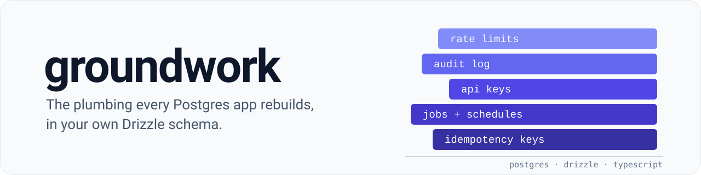

<div align="center">

<picture>
  <source media="(prefers-color-scheme: dark)" srcset="docs/assets/banner-dark.svg">
  
</picture>

<br>

**Rate limiting, audit logs, scoped API keys, background jobs and idempotency keys for TypeScript apps on Postgres. The tables live in your Drizzle schema, every write joins your transaction, and you don't need Redis.**

<br>

[](https://github.com/kaanxsrd/groundwork/actions/workflows/ci.yml)
[](https://www.npmjs.com/package/@vantedev/groundwork)
[](https://www.typescriptlang.org)
[](https://www.postgresql.org)
[](https://orm.drizzle.team)
[](docs/next.md)
[](https://nodejs.org/api/esm.html)
[](https://biomejs.dev)
[](LICENSE)

**[Quickstart](#quickstart)** ·
**[Docs](docs/README.md)** ·
**[Example app](examples/next-app)** ·
**[Changelog](CHANGELOG.md)** ·
**[Contributing](CONTRIBUTING.md)** ·
**[Security](SECURITY.md)**

</div>

<br>

> [!NOTE]
> **0.x:** the API can still change before 1.0. Each change is in the [changelog](CHANGELOG.md), with what to update.

## Why

Self-hosted Next.js + Drizzle + Postgres apps keep hand-writing the same five pieces. Libraries exist for each of them, but most bring their own schema, their own migrations, a Redis server or a hosted service. groundwork works differently:

- **Your schema.** The tables are factories you export from your own Drizzle schema, and your drizzle-kit migrates them. groundwork never runs DDL.
- **Your transaction.** Pass `{ tx }`, and an audit entry or an enqueued job commits or rolls back with the change that caused it.
- **Your names, typed.** Scopes, audit actions and job payloads are declared once, and TypeScript checks every place they're used.
- **Only Postgres.** A rate-limit check is one round trip. Redis is an option for rate limits, never a requirement.
- **Secure by default.** API keys, rate-limit subjects and idempotency keys are stored as HMACs under a secret you can rotate without re-issuing keys, comparisons are timing-safe, configured audit fields are redacted, and secrets never reach a log.

## What's inside

<table>
  <tr>
    <td width="50%" valign="top">

**[Rate limiting](docs/rate-limiting.md)**<br>
Fixed windows and token buckets in one atomic statement, with the standard `RateLimit` headers. If the database is down it falls back to memory, or fails open or closed, as you choose.

</td>
    <td width="50%" valign="top">

**[Audit log](docs/audit.md)**<br>
Typed actions recorded in your transaction, field-level diffs, redaction of secrets before they're stored, and keyset pagination that never skips a row.

</td>
  </tr>
  <tr>
    <td width="50%" valign="top">

**[Scoped API keys](docs/api-keys.md)**<br>
Keys that secret scanners recognise, stored as HMACs. Rotation with a grace period, suspension, IP and origin allowlists, and per-key rate limits and daily quotas.

</td>
    <td width="50%" valign="top">

**[Background jobs](docs/jobs.md)**<br>
Typed jobs enqueued in your transaction, one at a time or a thousand in one statement, and claimed in batches. Leases bring back a crashed worker's jobs, retries back off with jitter, a dedupe key can debounce, and schedules run each tick exactly once.

</td>
  </tr>
  <tr>
    <td width="50%" valign="top">

**[Idempotency keys](docs/idempotency.md)**<br>
Safe retries per the IETF draft. A repeated request gets the stored response; a duplicate that arrives while the first is still running gets a 409 and doesn't run twice.

</td>
    <td width="50%" valign="top">

**[Next.js helpers](docs/next.md)**<br>
`withApiKey`, `withRateLimit` and `withIdempotency` route wrappers that nest with full typing, a cron route for jobs, and client IPs read only from the proxy you trust.

</td>
  </tr>
</table>

## Quickstart

In a Next.js app (`npx create-next-app@latest`) with a Postgres database:

```sh
npm install @vantedev/groundwork drizzle-orm postgres
npm install -D drizzle-kit
```

**1. Add groundwork's tables to your Drizzle schema**, and let drizzle-kit create them. Put `DATABASE_URL` in `.env.local`, plus `GROUNDWORK_SECRET` and `CRON_SECRET`, each from `openssl rand -base64 32`.

```ts filename="db/schema.ts"
import { groundworkTables } from "@vantedev/groundwork/schema";

export const { rateLimits, auditLog, apiKeys, jobs, jobSchedules, idempotencyKeys } =
  groundworkTables();
```

```ts filename="drizzle.config.ts"
import { defineConfig } from "drizzle-kit";

process.loadEnvFile(".env.local");

export default defineConfig({
  dialect: "postgresql",
  schema: "./db/schema.ts",
  out: "./drizzle",
  dbCredentials: { url: process.env.DATABASE_URL ?? "" },
});
```

```sh
npx drizzle-kit generate
npx drizzle-kit migrate
```

**2. Create one instance** with your own names. Audit actions, API-key scopes and job payloads are typed from here on.

```ts filename="lib/groundwork.ts"
import { drizzle } from "drizzle-orm/postgres-js";
import { createGroundwork } from "@vantedev/groundwork";
import { createRouteHelpers } from "@vantedev/groundwork/next";
import postgres from "postgres";
import * as tables from "@/db/schema";

export const db = drizzle(postgres(process.env.DATABASE_URL ?? ""));

export const gw = createGroundwork({
  db,
  tables,
  secret: process.env.GROUNDWORK_SECRET ?? "",
  audit: { actions: ["note.create"] },
  apiKeys: { namespace: "demo", scopes: { "notes:write": "Create notes" } },
});

export const { withApiKey, withIdempotency } = createRouteHelpers(gw);

export const noteCreated = gw.jobs.define("note.created", {
  async run(note: { id: string }) {
    console.log(`Note ${note.id} was created.`);
  },
});
```

**3. Protect a route** with a scoped API key and make it safe to retry. The audit entry and the job commit together with your write, or not at all:

```ts filename="app/api/notes/route.ts"
import { db, gw, noteCreated, withApiKey, withIdempotency } from "@/lib/groundwork";

export const POST = withApiKey(
  ["notes:write"],
  withIdempotency(
    { scope: (_request, { apiKey }) => `apikey:${apiKey.id}` },
    async (request, { apiKey }) => {
      const { text } = await request.json();
      const id = crypto.randomUUID();
      await db.transaction(async (tx) => {
        await gw.audit.record(
          { actor: { type: "api_key", id: apiKey.id }, action: "note.create", metadata: { id, text } },
          { tx },
        );
        await noteCreated.enqueue({ id }, { tx });
      });
      return Response.json({ id }, { status: 201 });
    },
  ),
);
```

**4. Run jobs** from a cron route (Vercel Cron sends `CRON_SECRET` for you), or with `gw.jobs.work()` in a long-running process:

```ts filename="app/api/jobs/route.ts"
import { jobsRoute } from "@vantedev/groundwork/next";
import { gw } from "@/lib/groundwork";

export const GET = jobsRoute(gw, { secret: process.env.CRON_SECRET ?? "" });
export const POST = GET;
```

**5. Create a key** once, from a script or your admin UI, and call the route. A retry with the same `Idempotency-Key` gets the first response back:

```ts
const { key } = await gw.apiKeys.create({ name: "My CLI", scopes: ["notes:write"] });
```

```sh
curl -X POST http://localhost:3000/api/notes -H "Authorization: Bearer $KEY"   -H "Idempotency-Key: $(uuidgen)" -d '{"text":"Hello"}'
```

[`examples/next-app`](examples/next-app) uses every module, with rate limits, a schedule and an audit-log endpoint. CI builds both it and this quickstart in a fresh `create-next-app` project, then runs requests against them.

## The modules

Each one also works on its own, without `createGroundwork`: `createRateLimiter({ db, table, secret })`, and so on.

### Rate limiting

```ts
const login = gw.rateLimit.rule({ name: "login:ip", limit: 5, window: "15m" });
const api = gw.rateLimit.rule({ name: "api", algorithm: "token-bucket", rate: 10, per: "1s", burst: 120 });

const result = await login.check(ipSubject(ip));
if (!result.allowed) return new Response("Too many attempts", { status: 429, headers: result.headers });
```

`ipSubject()` counts an IPv6 client's whole `/64` as one subject, so it can't dodge a limit by switching addresses. Subjects are stored as HMACs, never as raw IPs or user ids. A batch that doesn't fit is rejected without using anything. [Docs](docs/rate-limiting.md)

### Audit log

```ts
await db.transaction(async (tx) => {
  const [before] = await tx.select().from(posts).where(eq(posts.id, id));
  const [after] = await tx.update(posts).set(input).where(eq(posts.id, id)).returning();
  await gw.audit.record(
    { actor: { type: "user", id: user.id }, action: "post.update", entity: { type: "post", id }, changes: diff(before, after) },
    { tx },
  );
});
const { entries, nextCursor } = await gw.audit.query({ entity: { type: "post", id } });
```

`record()` only accepts the actions you declared. [Docs](docs/audit.md)

### API keys

```ts
const { key } = await gw.apiKeys.create({ name: "CI deploy", scopes: ["posts:write"], expiresIn: "90d" });

const auth = await gw.apiKeys.verify(request, { scopes: ["posts:write"] });
if (!auth.ok) return auth.response; // a JSON 401, 403 or 429 with the right headers
```

The key is shown once; only its hash is stored. `rotate()` keeps the old key working for a grace period. [Docs](docs/api-keys.md)

### Background jobs

```ts
export const sendReceipt = gw.jobs.define("email.receipt", {
  schema: z.object({ orderId: z.string() }), // or any Standard Schema
  async run({ orderId }, { signal }) {
    await mailer.sendReceipt(orderId, { signal });
  },
});

await sendReceipt.enqueue({ orderId }, { tx, dedupeKey: `receipt:${orderId}` });
await sendReceipt.enqueueMany(orders.map((order) => ({ payload: { orderId: order.id } })), { tx });
gw.jobs.schedule("reports.nightly", { every: "1d" }, () => buildReports());
await gw.jobs.work({ concurrency: 4, signal }); // or runOnce() from a cron route
```

`enqueueMany` enqueues up to 1,000 jobs in one statement. With `replace: true`, a `dedupeKey` debounces instead: each call pushes the pending job back with the latest payload. [Docs](docs/jobs.md)

### Idempotency keys

```ts
return gw.idempotency.handle(request, { scope: `user:${user.id}` }, async () => {
  const order = await createOrder(await request.json());
  return Response.json(order, { status: 201 });
});
```

`run()` does the same for webhooks and anything else that isn't an HTTP handler. [Docs](docs/idempotency.md)

### Next.js

```ts
export const POST = withApiKey(
  ["posts:write"],
  withRateLimit(
    postWrites,
    (_request, { apiKey }) => apiKey.id,
    withIdempotency({ scope: (_request, { apiKey }) => `apikey:${apiKey.id}` }, createPost),
  ),
);
```

[Docs](docs/next.md)

## Compared with

There are good libraries for each of these pieces. groundwork's angle is having all five in your own schema and transactions. Here's when another tool fits better:

| You need | groundwork gives you | Consider instead |
| --- | --- | --- |
| Rate limiting | Fixed window and token bucket in your Postgres, hashed subjects, a memory fallback, optional Redis | [@upstash/ratelimit](https://github.com/upstash/ratelimit-js) on edge runtimes or without Postgres. [rate-limiter-flexible](https://github.com/animir/node-rate-limiter-flexible) for many more backends; its `RateLimiterDrizzle` also keeps its table in your schema (fixed window, no `tx`). |
| An audit log | Explicit, typed `record()` calls in your transaction, with diffs and redaction | [drizzle-audit](https://www.npmjs.com/package/drizzle-audit) to capture every ORM write automatically. Database triggers to also catch writes from outside your app. |
| API keys | Hashed, scoped keys in your database, with rotation grace, IP and origin allowlists and per-key limits | [Unkey](https://www.unkey.com), a hosted service with usage analytics. better-auth's [api-key plugin](https://www.npmjs.com/package/@better-auth/api-key) when keys belong to better-auth users and you need no more than it offers. |
| Background jobs | Typed jobs in your schema, enqueued in your transaction, leases, and a cron-friendly `runOnce()` | [pg-boss](https://github.com/timgit/pg-boss) or [graphile-worker](https://worker.graphile.org) for high volume, cron expressions, or job dependencies and workflows. Both bring their own schema and migrations. |
| Idempotency keys | The IETF draft's behaviour, with stored responses and crash recovery | Few libraries do this. If a payment provider is the only side effect, its own idempotency keys may be enough. |

groundwork isn't for edge runtimes, databases other than Postgres, or stacks that already run everything through Redis.

## Requirements

- PostgreSQL 16 or newer.
- `drizzle-orm` 0.45 with any Postgres driver (`postgres`, `pg`, Neon's websocket driver…). groundwork's own statements are all single statements; passing `{ tx }` needs a driver that supports transactions. CI tests `postgres` and `pg`. Drizzle 1.0 is supported once it's released; until then CI also runs the tests against its release candidate.
- Node.js 22+ or Bun 1.4+. ESM only.
- TypeScript 5.9+ if you use the types (CI checks 5.9, 6.0 and 7.0).
- For `@vantedev/groundwork/next`: nothing extra. It never imports `next`; CI tests it with Next.js 16.
- Optional: Redis, only for the Redis rate-limit store (tested with Redis 8, ioredis 6 and node-redis 6).

## Documentation

| Guide | What's inside |
| --- | --- |
| [Core concepts](docs/core-concepts.md) | Durations, the app secret and rotating it, errors, logging and clocks |
| [Table factories](docs/schema.md) | Putting groundwork's tables in your schema, column by column |
| [Rate limiting](docs/rate-limiting.md) | Algorithms, headers, failure modes, Redis |
| [Audit log](docs/audit.md) | Recording in transactions, diffs, redaction, querying, retention |
| [API keys](docs/api-keys.md) | Key format, scopes, verification, rotation, allowlists, per-key limits |
| [Background jobs](docs/jobs.md) | Workers, leases, retries, schedules, health |
| [Idempotency keys](docs/idempotency.md) | What's stored, status codes, crashes, `run()` |
| [Next.js helpers](docs/next.md) | Route wrappers, the jobs cron route, client IPs |
| [Testing your app](docs/testing.md) | Real Postgres, the test clock, calling routes directly |
| [Migrating](docs/migrating.md) | Moving off hand-rolled tables, module by module |
| [Example app](examples/next-app) | Every module in one Next.js 16 app |
| [Releasing](docs/releasing.md) | For maintainers: versions, provenance, trusted publishing |

## Develop

```sh
bun install
bun run db:up            # Postgres (127.0.0.1:54330) and Redis (:63790) in Docker
bun run check            # Biome, TypeScript and unit tests
bun run test             # everything, including the integration tests
bun run example          # the example app and this README's quickstart, built and run
```

[CONTRIBUTING.md](CONTRIBUTING.md) explains the test harness, the migration workflow and the conventions. [PLAN.md](PLAN.md) has the roadmap and every design decision.

## License

[MIT](LICENSE) © Vante

<div align="center">
<br>
<sub>Built to be the last time you write a rate limiter.</sub>
</div>
